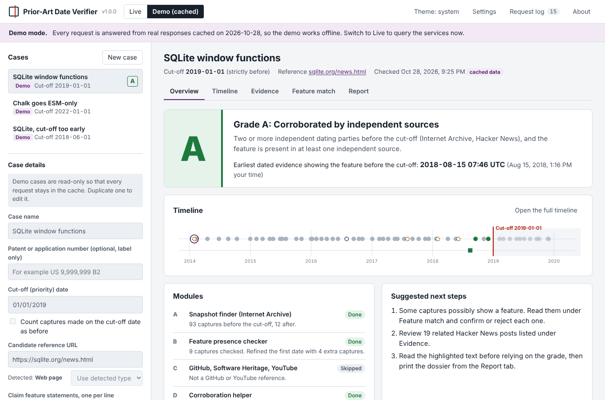
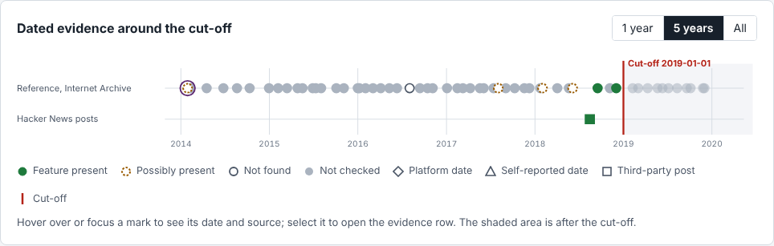
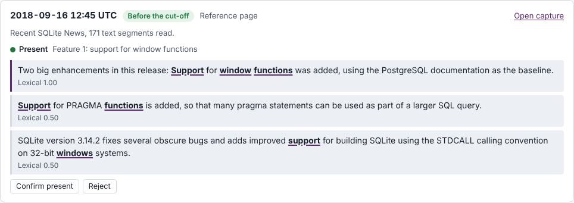
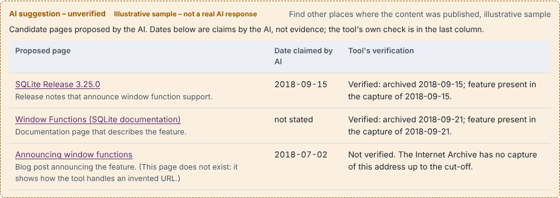
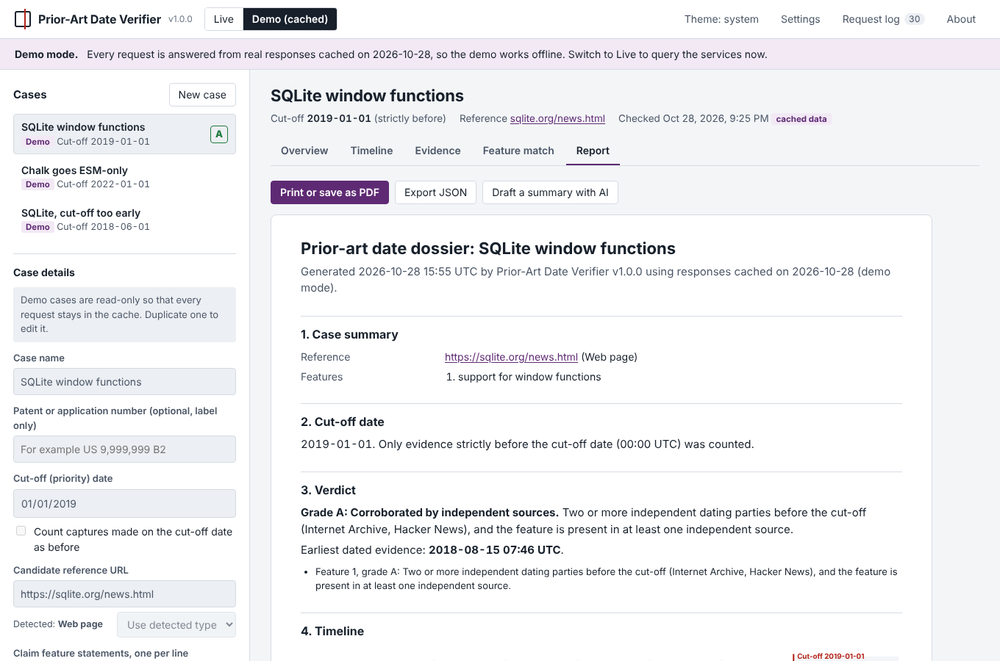

# Prior-Art Date Verifier

A browser tool for patent research analysts. Give it a web page, YouTube video or GitHub repository, a patent's cut-off (priority) date and the claim features you need. It finds dated evidence that the reference was public before the cut-off, reads archived copies for the features, grades the evidence A to D, and prints a dossier.

Everything runs in the browser from a single `index.html`: no server, no build step. It works on GitHub Pages and when opened straight from disk.

> **AI suggests, the tool verifies, the analyst decides.**



## 1. Problem and purpose

In invalidity and system prior-art searches, finding a technically matching non-patent reference (a web page, a video, a repository, an app changelog) is often quick. The slow step is proving that the reference was **publicly available before the cut-off date**. Published case studies from IP research firms describe this repeatedly:

- a YouTube video that needed corroboration (the uploader's tweet, a Facebook post, the app's update logs), because a European ruling held that a YouTube screenshot alone was not enough;
- source code that had to be shown publicly accessible before a 2004 cut-off;
- a clinical-trial record whose historical versions had to be checked;
- a product website that lagged behind the product's packaging, so the live page alone gave the wrong answer.

Today an analyst checks archives, posts, changelogs and version histories one by one. This tool does the first pass and assembles an evidence dossier. The analyst still makes the final judgement.

## 2. Features

| Module | What it does |
|---|---|
| A. Snapshot finder | Lists Internet Archive captures through the CDX index (one per month up to the cut-off, a few after). Tries URL variants (http/https, www, trailing slash) and reports which one matched. Reports redirect-only captures, robots exclusions and rate limits. Falls back to the availability API when the index cannot be reached. |
| B. Feature checker | Reads up to five captures before the cut-off as raw archived HTML (the `id_` form, without the archive toolbar), extracts text safely with `DOMParser`, and scores every sentence against every feature. Then narrows down the first capture that shows the features. Optional semantic matching with `all-MiniLM-L6-v2` through Transformers.js. |
| C. Source dates | GitHub: repository creation, releases, tags and matching commits (each with a note on how strong it is). Software Heritage: first archival visit. YouTube: upload date (needs an API key). |
| D. Corroboration | Searches Hacker News for related posts before the cut-off, checks any corroborating URLs you add, and builds ready-made Google, Bing, X and Reddit searches limited to the cut-off. |
| E. Grader | Rule-based, transparent grades A to D, with "Why this grade" for every feature. |
| F. Dossier | Printable report (save as PDF), JSON export of the whole case including raw responses, JSON import. |
| AI fallback | Optional Google Gemini layer that steps in when a module fails or finds nothing. Its output is never counted until the tool has verified it. |

Also: an SVG timeline with the cut-off line, a request log, cases saved in the browser, light and dark themes, keyboard navigation, and a demo mode that works offline.

| Timeline | Feature match |
|---|---|
|  |  |

| AI candidates checked by the tool | Report |
|---|---|
|  |  |

## 3. How to use

1. Open the page and choose **New case**.
2. Enter the reference URL, the cut-off date and one claim feature per line (short statements in the words the page is likely to use work best).
3. Optionally add corroborating URLs you have already found.
4. Choose **Run the check**.
5. Read the **Overview** (grade, key date, module status, next steps), then the **Timeline**, **Evidence** and **Feature match** tabs. Confirm or reject any verdict under Feature match; your decision changes the grade and is marked in the report.
6. Print or save the dossier from the **Report** tab, or export the case as JSON.

## 4. Live and demo modes

The switch is in the top bar.

- **Demo (cached)** answers every request from responses captured from the real services on **2026-10-28** and embedded in `index.html`. It works with no network. Each request in the log is marked "cached on 2026-10-28". Three demo cases are included:

  | Demo case | Reference | Cut-off | Result |
  |---|---|---|---|
  | SQLite window functions | `https://sqlite.org/news.html` | 2019-01-01 | **A**. The feature first appears in the capture of 2018-09-16; a third-party Hacker News post of 2018-08-15 announces it. |
  | Chalk goes ESM-only | `https://github.com/chalk/chalk` | 2022-01-01 | **B**. The v5.0.0 release (GitHub, 2021-11-26) says the package is pure ESM; no independent source shows the feature yet. |
  | SQLite, cut-off too early | `https://sqlite.org/news.html` | 2018-06-01 | **D**. Nothing before the cut-off shows the feature; some "Windows" sentences are flagged as possible matches for the analyst to reject. |

  Demo cases are read-only so that every request stays in the cache; duplicate one to edit it.

- **Live** sends real requests. Without a proxy, `web.archive.org` cannot be read from a web page (see section 6), so captures are sampled through the availability API and archived pages cannot be read. With the proxy Worker, everything works.

## 5. Settings

- **CORS proxy prefix**: the address of your Worker followed by `?url=`, for example `https://padv-proxy.your-name.workers.dev/?url=`.
- **YouTube Data API key**: needed only for YouTube references. Create it in Google Cloud Console with the YouTube Data API v3 enabled, and restrict it to your site (HTTP referrer `https://your-name.github.io/*`).
- **Gemini API key**: optional, from Google AI Studio. Restrict it to the Generative Language API and to your site's address.
- Keys are kept in memory and saved in the browser only if you tick "Remember on this device". No key is ever in the repository.
- Matching thresholds, captures to read, first-date narrowing and semantic matching can be changed. In demo mode the defaults are always used so that every request stays in the cache.

### Deploying the proxy Worker (about five minutes, free)

`cors-proxy-worker.js` forwards GET requests only to `web.archive.org`, `archive.org` and `archive.softwareheritage.org`, refuses every other host (including redirects to other hosts), and adds CORS headers. It also resolves Google Search redirect links without fetching their targets.

1. Create a free account at <https://dash.cloudflare.com> and open **Workers & Pages**.
2. Create a new Worker (the "Hello World" starter is fine) and deploy it.
3. Choose **Edit code**, replace everything with the contents of `cors-proxy-worker.js`, and deploy again.
4. Optional: set `ALLOWED_ORIGINS` to `['https://your-name.github.io']` so only your site can use it.
5. Copy the Worker's address, add `?url=`, and paste it into **Settings → CORS proxy prefix**.

## 6. CORS findings

Checked on 2026-10-28 by calling each endpoint with `fetch()` in a desktop Chromium browser, from a normal web page (`https://example.com`, the same situation as GitHub Pages) and from a page with origin `null` (the situation when `index.html` is opened straight from disk).

| Endpoint | From a web page | From a local file | How the tool uses it |
|---|---|---|---|
| Wayback CDX index `web.archive.org/cdx/search/cdx` | **No** | **No** | Through the proxy; otherwise the availability API is used |
| Archived pages `web.archive.org/web/<ts>id_/<url>` | **No** | **No** | Through the proxy; otherwise Module B reports that it needs the proxy |
| Wayback availability `archive.org/wayback/available` | Yes, but slow (up to about 5 s) and sometimes answers "nothing" for an archived page | **No** | Fallback sampling of captures; empty answers are asked once more |
| Software Heritage API `archive.softwareheritage.org/api/1/…` | Yes | Yes | Direct |
| GitHub REST API `api.github.com` | Yes (60 requests per hour without sign-in) | Yes | Direct |
| YouTube Data API `www.googleapis.com/youtube/v3` | Yes (needs a key) | Yes, unless the key is restricted to your site's address | Direct |
| Hacker News search `hn.algolia.com/api/v1/search` | Yes | Yes | Direct |
| Gemini `generativelanguage.googleapis.com` | Yes, including the preflight for the `x-goog-api-key` header | Yes | Direct (not added to the proxy) |

So: use the published GitHub Pages address (or serve the folder with `python -m http.server`) for live checks. Opened from disk, the tool says so in a banner and skips the Internet Archive instead of failing silently.

## 7. Grading rules

Every dated source is classed by **who recorded the date**:

- **Independent**: a third party recorded it (Internet Archive capture, Software Heritage visit, a Hacker News post by someone else).
- **Platform-recorded**: the hosting platform recorded it (YouTube `publishedAt`, GitHub release `published_at`, repository creation).
- **Self-reported**: the author supplied it (commit and tag dates, dates written in the page).
- **AI suggestion**: never counted.

| Grade | Rule |
|---|---|
| A | Two or more independent dating parties before the cut-off, and the feature is present in at least one independent source |
| B | One independent or platform-recorded source shows the feature before the cut-off |
| C | Only self-reported dates show the feature before the cut-off |
| D | No dated evidence before the cut-off, or the feature is not shown in any checked source before it |

Independence is counted by party: ten Internet Archive captures are one witness, not ten. With several features, each is graded and the case takes the weakest grade. The key date is the earliest source that satisfies the rule. Analyst decisions under Feature match override the automatic verdicts and are marked in the report.

## 8. AI fallback (Google Gemini)

The AI layer is off until a key is entered. It runs automatically only when a module fails or finds nothing (Wayback blocked or empty, YouTube key missing, GitHub rate limit, semantic model failure, no corroboration), and can be started by hand from **AI assist**.

| Task | What happens to the answer |
|---|---|
| Find other publications (Google Search grounding) | Every URL, including grounding sources, goes to "Candidates to verify". The tool looks each one up in the Internet Archive and reads it for the features. Only that verified result can enter the evidence table. Search redirect links are resolved through the proxy. |
| Check matches with AI | Each quotation must appear word for word (after whitespace and quote normalisation) in text the tool fetched itself. Otherwise it is discarded and the discard is logged. |
| Suggest searches | A checklist of searches; nothing is graded. |
| Read archived pages (URL context) | Shown as unverified readings when the tool cannot fetch the pages itself. |
| Draft a summary | Written only from the verified evidence table; rejected if it mentions any URL or date that is not in the table. |

Safeguards: every AI item is labelled "AI suggestion – unverified" in the interface, the report and the export; dates claimed by the AI never appear on the timeline; you can see exactly what will be sent before each call; analyst notes and cases marked confidential are never sent; the key travels in the `x-goog-api-key` header, never in a URL, and is never logged. The system instructions are in one constant, `AI_SYSTEM_INSTRUCTIONS`, in `index.html`.

> Client matters at IP firms are usually confidential, and sending them to a public AI API may not be permitted. The AI layer stays off until a key is entered. The demo cases use public data only.

**Gemini API details, checked against Google's documentation on 2026-10-28**

- Endpoint: `POST https://generativelanguage.googleapis.com/v1beta/models/<model>:generateContent`. Google now recommends its newer Interactions API for new projects but states that `generateContent` remains fully supported.
- Default model: `gemini-3.8-flash` (listed as stable). The model ID is editable in Settings.
- Google Search grounding is requested with `"tools": [{ "google_search": {} }]`, URL reading with `{ "url_context": {} }`.
- Combining JSON structured output with these tools is documented as a preview feature for some models only, so the tool always makes two calls: a grounded call first, then a separate structured extraction without tools. Structured output uses `responseJsonSchema`, with an automatic retry using `responseSchema` for models that need it.
- Invalid JSON is retried once with a stricter instruction; after that the raw answer is shown and the task is marked failed.

The AI path was tested against simulated Gemini responses. No real Gemini call was made during the build because no key was available; the demo's AI answers are therefore marked **"Illustrative sample – not a real AI response"**. The tool's verification of those samples is real.

## 9. Limitations

- The tool assists an analyst. It does not decide legal sufficiency or admissibility, or which cut-off date applies; that depends on jurisdiction, priority claims and grace periods.
- Wayback coverage is incomplete. The absence of a capture does not prove the page did not exist.
- An archived page can mix resources captured at different times. The tool checks only the archived HTML text of the captured page.
- Pages rendered by JavaScript may have been archived without their content.
- Git commit dates are self-reported, and a release can be created after the code it points to.
- YouTube titles and descriptions can be edited after upload.
- Lexical and semantic matching can give false positives and false negatives (for example "Windows" matching "window"). The analyst must read the highlighted text.
- AI suggestions can be wrong or invented. The tool counts only what it verifies itself.
- Narrowing the first date assumes that once the features appear on a page they stay there.

## 10. Deployment on GitHub Pages

1. Create a public repository and push these files to the `main` branch: `index.html`, `tests.html`, `vendor/`, `cors-proxy-worker.js`, `README.md`, `LICENSE`, `screenshots/` and the empty `.nojekyll` file (it tells GitHub Pages to serve the files as they are).
2. In the repository, open **Settings → Pages**.
3. Under "Build and deployment", choose **Deploy from a branch**, then branch **main** and folder **/ (root)**, and save.
4. After a minute or two the site is at `https://<your-name>.github.io/<repository>/`.
5. Open it, switch to **Live**, and run one case before any demonstration.

`vendor/vue.global.prod.js` is a copy of Vue 3.5.44 (MIT). The page loads Vue from jsDelivr with an integrity hash and falls back to this copy when the CDN cannot be reached, so the demo also works offline.

## 11. Tests

Open `tests.html` from the deployed site, or serve the folder locally (`python -m http.server`) and open `http://localhost:8000/tests.html`. It loads the core logic straight from `index.html` and runs 61 plain assertions: timestamp parsing, cut-off comparison including the "on the cut-off day" toggle, URL variants, YouTube and GitHub detection, text extraction, lexical scoring, every grade, AI items never counting, quotation checks, summary checks, schema validation, retries, timeouts, the demo cache, the proxy, and key handling.

Results of the build checks (2026-10-28):

- Unit tests: 61 passed, 0 failed.
- Demo mode with the network blocked: all three demo cases give A, B and D; no request missed the cache; no console errors apart from the blocked CDN, after which the local Vue copy loaded.
- Live pipeline: the same core code was run against the real services in a desktop browser on 2026-10-28 (this run produced the demo cache): SQLite web page case **A**, Chalk GitHub case **B**, early cut-off case **D**.
- Live mode in the interface: tested end to end with simulated services, covering the proxy, redirect resolution, the availability fallback without a proxy, automatic AI fallback, quotation rejection, confidential cases, an invalid key, export, reload and import.
- Semantic matching: Transformers.js 4.3.2 and `Xenova/all-MiniLM-L6-v2` loaded and ran in a desktop browser.
- Layout checked at 1360 px and 360 px wide (no horizontal page scroll), in light and dark themes, and in print preview.

## 12. Three-minute demonstration

1. **The problem (30 s).** "Finding a matching page is quick. Proving it was public before the priority date is slow: archives, posts, changelogs, one by one. This tool does the first pass."
2. **Demo case 1 (60 s).** Select *SQLite window functions*, run it. Point to grade A, the key date, and the timeline: hollow marks before 2018, then filled marks from September 2018, all left of the red cut-off line. Open Feature match to show the highlighted sentence and the first-date narrowing.
3. **Grade D (30 s).** Run *SQLite, cut-off too early*. The tool does not always say yes; the "Windows" matches are flagged as possible for the analyst to reject.
4. **AI, kept in its place (30 s).** On case 1, choose *Find other publications*: one invented URL fails verification, two real pages are verified from the archive. *Check matches with AI*: the paraphrased quotation is discarded.
5. **Dossier and limits (30 s).** Open Report, print to PDF, and name two limitations: archive coverage gaps, and that the grade is not a legal conclusion.

## 13. Project structure

```
index.html              the whole application (styles, templates, core logic, interface, demo cache)
tests.html              browser-run unit tests (loads the core from index.html)
cors-proxy-worker.js    optional Cloudflare Worker, allowlisted hosts only
vendor/vue.global.prod.js   local copy of Vue 3.5.44, used if the CDN is unreachable
screenshots/            images used in this README
.nojekyll               tells GitHub Pages not to process the files
README.md, LICENSE
```

Inside `index.html`, the `<script id="padv-core">` block holds all evidence logic (no interface code), and the last script holds the Vue interface. To update the screenshots, run a demo case, take a screenshot of each tab and replace the files in `screenshots/` with the same names.

## 14. Known issues

- Without the proxy, live mode can only sample captures and cannot read archived pages. Deploy the Worker before a live demonstration.
- Opened straight from disk, the page cannot reach the Internet Archive at all (its availability service refuses local files). Use the published site for live checks; demo mode works either way.
- The Internet Archive rate-limits heavy use (HTTP 429). The tool retries once, limits itself to three parallel archive requests, stops its sampling at the first rate-limit answer, and asks you to wait.
- GitHub allows 60 unsigned API requests per hour; a GitHub case uses about ten.
- Search grounding sources are Google redirect links; without the proxy they are listed but cannot be verified.
- The semantic model (about 23 MB) is downloaded from the Hugging Face hub the first time it is used. In a test on 2026-10-28 it loaded in about 13 seconds; a clear match scored 0.59, an unrelated "Windows" sentence 0.19. Semantic scores are therefore set to count as present only from 0.60.

## 15. Future work

- **Product-specification drift monitor** for evidence-of-use work: track a specification value across the live page, archived copies and manuals, and flag when it crosses a claim threshold (as when a website says CRI ">80" but the packaging says 90).
- **Clinical-trial registry history**: compare dated versions of registry records.
- **Supplementary data search**: look inside supplementary tables of research papers, where claim limitations are often hidden.

## Licence

MIT. See `LICENSE`.
